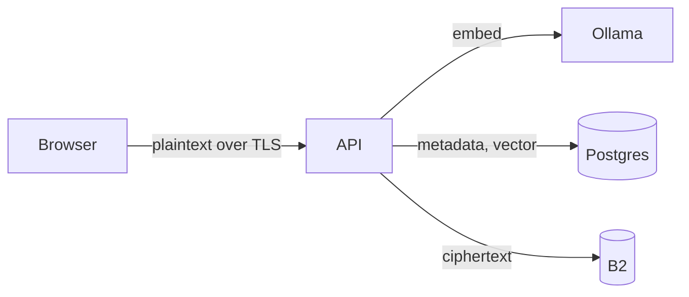
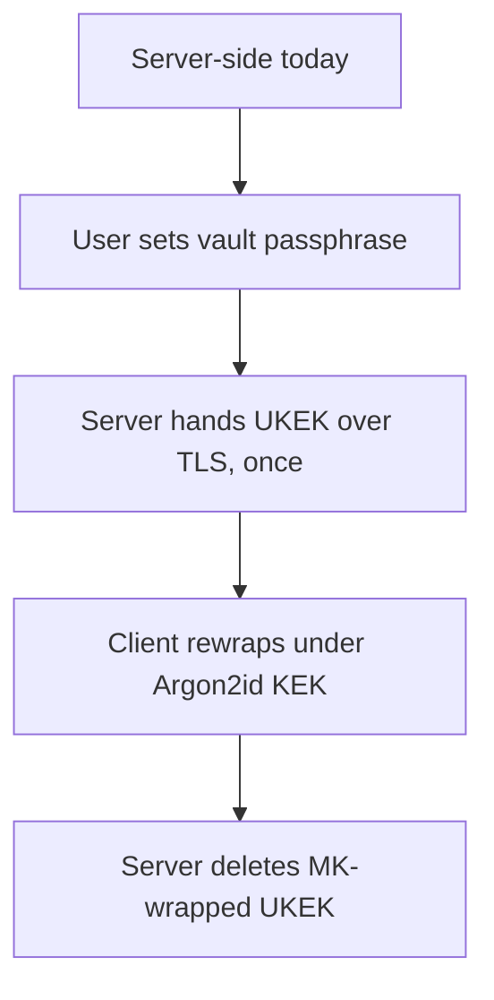
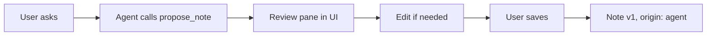
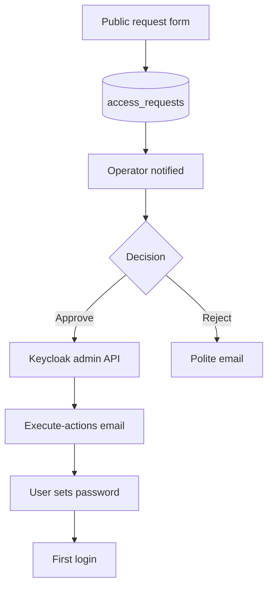

# AI Diary — Build Specification

As of 2026-09-19

## Purpose and scope

A self-hosted personal diary. Notes are plain-text files stored encrypted in S3-compatible object storage, indexed in Postgres, searched semantically via pgvector, and queried through a chat agent running on the user's own LLM endpoint.

Built for the operator plus fewer than ten invited users. Not a product and not multi-tenant SaaS. Every choice below assumes small scale and an operator who is also a user.

### Decisions locked in

These were settled during specification. The reasoning is recorded so a later reader knows what was traded away.

| Area | Decision | Why |
| --- | --- | --- |
| Encryption | Server-side envelope encryption, E2EE migration path documented | Browser-delivered E2EE stops a passive operator, not an active one. It would also cost server-side embedding, cron jobs, debuggability and a second passphrase. |
| Vector store | pgvector, not Chroma | Removes a service, inherits Postgres backups, has a maintained EF Core provider. Chroma has no official .NET client. |
| Embeddings | Existing Ollama running `bge-m3` | Already deployed, free, multilingual, 8192-token context. Fixes the vector column at 1024 dimensions. |
| Identity | Keycloak | Admin-provisioned users plus `execute-actions-email` gives approve-then-email-to-set-password in one API call. No flow authoring, no hand-rolled password reset. |
| Stack | ASP.NET Core API + React/TypeScript SPA | Matches existing expertise. Editor and client logic sit in the browser tier either way. |
| Editor | Plain `<textarea>`, Markdown on disk | iOS autocorrect, predictive text, swipe typing and dictation all degrade on `contenteditable`. |
| File format | `.md`, CommonMark plus GFM tables | Frontmatter becomes machine-readable in Obsidian, Pandoc and Hugo. Makes v2 attachments and git export coherent. |
| Search | Semantic only | Keyword search would need plaintext or a `tsvector` in Postgres, making a dump directly readable. |
| Offline | None; online-only web app | Removes service worker, sync queue and conflict resolution from v1. |
| Attachments | Designed for, built in v2 | Keeps v1 at one text object per note while making images additive. |
| Versioning | Immutable versions in Postgres and S3, not git | Encrypted blobs defeat git's delta compression and diffs. Git needs a filesystem; storage here is object storage. Diaries are single-author and linear. |
| Agent authority | Proposes drafts, never writes | The approval gate is explicit and the draft is editable before saving. |

## Architecture

Five services. Only the API and Keycloak are reachable from the internet; everything else sits on a private Docker network with no published ports.

| Service | Role | Exposed |
| --- | --- | --- |
| `web` | React SPA, static assets behind Traefik | Yes |
| `api` | ASP.NET Core, the only component holding the master key | Yes |
| `postgres` | Identity index, note metadata, versions, embeddings, conversations | No |
| `keycloak` | OIDC provider, user store, password and email flows | Yes |
| `ollama` | `bge-m3` embeddings, already running in the n8n stack | No |

Object storage is Backblaze B2 over the S3-compatible API, reached directly by the browser through presigned URLs.

### Write path



The API receives plaintext, encrypts it, writes the ciphertext to B2 and the metadata plus embedding to Postgres. Plaintext exists only in API memory and is never logged.

### Read path

The browser asks the API for a note. The API returns a short-lived presigned GET URL, the browser fetches the ciphertext from B2 directly, and the API returns the unwrapped data key over TLS for the browser to decrypt. Note bodies therefore do not transit the API on read, which keeps large fetches off the app server.

### Trust boundaries

- Browser to API: TLS. Plaintext crosses here on write.
- API to B2: only ciphertext ever crosses.
- API to Ollama: plaintext crosses, on a private network, to a service that persists nothing.
- Browser to the user's LLM endpoint: plaintext crosses, outside the operator's control, by the user's own choice.

The master key lives in an environment variable, never in Postgres, so a database dump alone cannot decrypt anything.

## Encryption and key management

Three-level envelope encryption. The master key lives in an environment variable, so a stolen Postgres dump and a stolen B2 bucket together still decrypt nothing.

| Key | Scope | Where it lives |
| --- | --- | --- |
| Master Key (MK) | Deployment | `DIARY_MASTER_KEY` env var, 256-bit, base64. Never in Postgres, never in a backup |
| User Key (UKEK) | One per user | Random 256-bit, wrapped by MK, stored in `users.wrapped_ukek` |
| Data Key (DEK) | One per note, shared by its versions | Random 256-bit, wrapped by UKEK, stored in `notes.wrapped_dek` |
| Recovery Key | One per user | Second wrapping of the UKEK. Shown once at first login, never stored in the clear |

Cipher is AES-256-GCM throughout, with a fresh 96-bit random nonce per object and a 128-bit tag.

### File envelope

Every object in B2 is self-describing, so a reference decryptor needs only the file and the user's key.

| Offset | Bytes | Field |
| --- | --- | --- |
| 0 | 5 | Magic `WNMD1` |
| 5 | 1 | Format version |
| 6 | 16 | Note ID, as raw UUID |
| 22 | 4 | Version number, big-endian u32 |
| 26 | 12 | GCM nonce |
| 38 | n | Ciphertext |
| 38+n | 16 | GCM tag |

Note ID and version number are the GCM additional authenticated data. That binds each object to its identity, so an attacker with bucket write access cannot swap one note's ciphertext into another note's slot undetected.

Overhead is 54 bytes per object.

### Recovery key

Generated server-side at first login, returned once, displayed once, and never persisted in plaintext. Presented as a 26-character Base32 string in five groups, with a downloadable recovery kit containing the key, the user ID and a link to the decryptor.

Losing it is survivable while the deployment is healthy, because the master key can still unwrap the UKEK. It matters only if the operator's environment is lost.

### Reference decryptor

The repository ships a standalone decryptor, as a .NET console tool and a single-file Python script with no dependencies beyond the standard library. It takes a recovery key and a directory of `.md.enc` files and writes plain `.md` out. This is the guarantee that the archive outlives the application.

### Key rotation

Rotating the master key rewraps every UKEK and touches no note. Rotating a recovery key rewraps one UKEK. Neither operation re-encrypts anything in B2, because the DEKs are unchanged.

### Migration path to E2EE

The ciphertext format above does not change under end-to-end encryption. Only the question of who unwraps the UKEK changes, which is why the format is worth getting right now.



What would then have to move client-side: embedding generation, agent orchestration, and title decryption for the sidebar. What would keep working untouched: the retention reaper, which deletes by date and never reads content, and every object already in B2.

Embeddings would need regenerating in the browser with a secret per-user rotation applied, since cosine similarity is invariant under rotation but inversion attacks are not.

## Storage and file format

Backblaze B2 over the S3-compatible API, EU Central. Object keys are opaque, because the user can edit a note's entry date and a date-derived path would require moving objects on every correction.

```
u/{user_id}/n/{note_id}/v{version_no}.md.enc
u/{user_id}/a/{attachment_id}.enc          # reserved for v2
```

The human filename is not the object key. It is recorded in `note_versions.filename` and applied only at export or manual decryption, as `{entry_date}-{slug(title)}.md`.

### Bucket configuration

- Versioning off. Versioning is handled by the application, and two retention systems is how surprise billing happens.
- One lifecycle rule as a backstop only, set generously wide, never as the mechanism.
- CORS allowing `PUT` and `GET` from the app origin, with `ETag` exposed.
- Presigned URLs expire in 300 seconds.

### Decrypted file contents

CommonMark plus GFM tables. YAML frontmatter, then the body.

```markdown
---
id: 0199a4f1-3c2e-7b8a-9d10-4e5f6a7b8c9d
title: Rain on the canal
entry_date: 2026-09-14
created_at: 2026-09-14T21:04:11Z
timezone: Europe/Amsterdam
location:
  lat: 52.1749
  lon: 5.0009
  label: Breukelen
version: 3
origin: user
---

Body text starts here.
```

`origin` is `user` or `agent`, so an entry the chat agent drafted stays distinguishable later. `location` is omitted entirely when absent rather than written as null.

### Frontmatter handling

The frontmatter is generated by the server on write and stripped on read. The editor only ever receives the body.

One mandatory guard: if the body's first line is `---`, escape it on write, otherwise the next load silently parses part of the body as frontmatter. Postgres is the authoritative source for all metadata; the frontmatter is a portability convenience, so a parse failure on read should log and fall back to the database rather than fail the request.

### Encoding rules

UTF-8, no BOM. `\n` line endings, normalised on write. Exactly one trailing newline. Without this, notes written on macOS and on iOS diff against each other for no reason.

## Data model

Postgres 16 with the `vector` extension. EF Core with `Pgvector.EntityFrameworkCore`. No note body ever lands here.

### users

Mirrors Keycloak rather than replacing it. Keycloak owns credentials; this table owns key material and app state.

| Column | Type | Notes |
| --- | --- | --- |
| `id` | uuid PK | Application identifier |
| `keycloak_sub` | text unique | OIDC subject claim, the join key |
| `email` | citext unique | Denormalised for the admin list |
| `wrapped_ukek` | bytea | UKEK under the master key |
| `recovery_wrapped_ukek` | bytea | UKEK under the recovery key |
| `recovery_acknowledged_at` | timestamptz null | Null until the user confirms they saved the kit |
| `llm_endpoint_url` | text null | BYO chat endpoint |
| `llm_api_key_enc` | bytea null | Encrypted under the UKEK |
| `llm_model` | text null | Model identifier sent to that endpoint |
| `is_admin` | boolean | Single operator flag; no role table at this scale |
| `created_at` | timestamptz | |

### notes

| Column | Type | Notes |
| --- | --- | --- |
| `id` | uuid PK | UUIDv7, so ordering is meaningful |
| `user_id` | uuid FK | |
| `wrapped_dek` | bytea | Shared by every version of this note |
| `title_enc` | bytea | Encrypted title, decrypted server-side to render the sidebar |
| `entry_date` | date | User-editable. The sidebar groups by this |
| `created_at` | timestamptz | Immutable system timestamp |
| `updated_at` | timestamptz | |
| `timezone` | text | IANA zone captured at creation |
| `location_lat` | double null | |
| `location_lon` | double null | |
| `location_label_enc` | bytea null | Place name is content, so it is encrypted |
| `current_version` | integer | |
| `deleted_at` | timestamptz null | Soft delete; purged 30 days later |
| `origin` | text | `user` or `agent` |

Index on `(user_id, entry_date DESC)` for the sidebar and on `(user_id, deleted_at)` for the trash view.

Latitude and longitude are stored in the clear because they are needed for any future map view and are low value alone. The human-readable place label is encrypted, because a label naming a person's home is content.

### note_versions

| Column | Type | Notes |
| --- | --- | --- |
| `id` | uuid PK | |
| `note_id` | uuid FK | |
| `version_no` | integer | Unique with `note_id` |
| `s3_key` | text | |
| `filename` | text | Export filename at the time of writing |
| `byte_size` | integer | Ciphertext length |
| `content_hash` | bytea | SHA-256 of plaintext, for no-op save detection |
| `created_at` | timestamptz | |
| `superseded_at` | timestamptz null | Null means current. Starts the retention clock |

Index on `superseded_at` where not null, for the nightly reaper.

### note_embeddings

| Column | Type | Notes |
| --- | --- | --- |
| `note_id` | uuid PK FK | One vector per note; `bge-m3` handles 8192 tokens |
| `user_id` | uuid FK | Denormalised so every query filters on it |
| `embedding` | vector(1024) | |
| `model` | text | Recorded so a model change is detectable |
| `generated_at` | timestamptz | |

HNSW index with `vector_cosine_ops`. Under ten users, an IVFFlat index would need retraining for no benefit.

### conversations and messages

`conversations` holds `id`, `user_id`, `title_enc`, `created_at`, `last_message_at`. `messages` holds `id`, `conversation_id`, `role`, `body_enc`, `cited_note_ids` as a uuid array, and `created_at`.

Both are purged 30 days after `last_message_at` by the same reaper that handles versions.

### access_requests

| Column | Type | Notes |
| --- | --- | --- |
| `id` | uuid PK | |
| `email` | citext | |
| `message` | text null | Optional note from the requester |
| `status` | text | `pending`, `approved`, `rejected` |
| `requested_at` | timestamptz | |
| `decided_at` | timestamptz null | |
| `source_ip` | inet | Abuse tracking only, purged after 90 days |

## Versioning and retention

Saves never overwrite. Each save writes a new immutable object and a new `note_versions` row, then stamps `superseded_at` on the previous row and bumps `notes.current_version`.

A save whose plaintext SHA-256 matches `content_hash` of the current version is a no-op. Without this, autosave creates a version every time the editor blurs.

### Retention rule

- The current version of every note is retained indefinitely.
- A superseded version is retained for 90 days from the moment it was superseded, not from when it was created.

The clock starts at supersession, so a note written in January and first edited in May keeps its original until August. That is the whole point of the rule and it is easy to get wrong.

### Reaper

One nightly hosted service handles every retention task. Deletes are B2-first, then Postgres, so a crash leaves an orphaned row rather than a dangling key.

| Target | Condition |
| --- | --- |
| Superseded versions | `superseded_at < now() - 90 days` |
| Trashed notes | `deleted_at < now() - 30 days`, all versions and the embedding |
| Conversations | `last_message_at < now() - 30 days` |
| Access request IPs | `requested_at < now() - 90 days`, IP nulled, row kept |

B2 lifecycle rules cannot express the supersession rule, because each version has its own key and `daysFromHidingToDeleting` only fires when a newer file lands on the same key. Retention is therefore application-level by necessity, which is also the safer outcome. Keep any bucket lifecycle rule wide enough that it never fires in normal operation.

### History UI

A version list per note showing timestamp, byte size and origin. Selecting two versions fetches both, decrypts them in API memory, runs a line diff and returns rendered HTML. Plaintext is never written to disk or logged during this.

Restore writes a new version whose content equals the old one. History is append-only and is never rewritten.

## Embeddings and search

One vector per note, generated by `bge-m3` on the existing Ollama instance. The model's 8192-token context covers a diary entry whole, so there is no chunking and no chunk table.

Embedding input is the title followed by a blank line and the body, truncated at 8000 tokens. Frontmatter is excluded.

### Generation

Embedding runs as a background job after the save commits, not inline. A cold model load can take seconds and no save should wait on it. `note_embeddings.generated_at` older than the note's `updated_at` marks a stale vector, which the reaper re-queues.

At this scale a Postgres-backed job table polled every few seconds is sufficient. No Redis, no message broker.

### Network

The API container must reach Ollama, which currently lives in a different Coolify stack with no published ports. Either attach the API to that stack's network or move Ollama to a shared external network. Do not publish an Ollama port to solve this.

### Query

```sql
SELECT note_id, 1 - (embedding <=> @q) AS score
FROM note_embeddings
WHERE user_id = @uid
ORDER BY embedding <=> @q
LIMIT @k;
```

The `user_id` filter is applied from the OIDC subject server-side and is never accepted as a request parameter. This is the entire tenant isolation mechanism, so it belongs in a repository method that no caller can bypass rather than in each endpoint.

Default `k` is 8, with a minimum score threshold below which results are dropped rather than padded.

### Known limitation

Dense-only retrieval is weak on exact strings and proper nouns. Searching a specific name may not surface the entry containing it. Through Ollama only the dense head of `bge-m3` is available, so there is no sparse or hybrid fallback.

This is a deliberate acceptance, not an oversight. The mitigation is the deep scan in the v2 section, and the spec should not attempt to compensate by adding a plaintext index.

## Chat agent

Each user supplies their own OpenAI-compatible endpoint URL, API key and model name. The key is encrypted under the user's UKEK. The API acts as a relay so that browser-side CORS restrictions at the provider do not break the feature.

The relay never logs request or response bodies and never persists the decrypted key beyond the request.

### Tool contract

Two tools. The agent can read notes and can propose one, but cannot write.

| Tool | Arguments | Returns |
| --- | --- | --- |
| `search_notes` | `query`, optional `date_from`, `date_to`, optional `limit` | Array of note ID, entry date, title, body excerpt, score |
| `propose_note` | `title`, `body`, `entry_date` | A draft object. Writes nothing |

`search_notes` runs the pgvector query from the previous section, scoped to the calling user. Date filters become a SQL predicate on `entry_date`, not a post-filter, so a date-bounded question does not exhaust `k` on out-of-range notes.

### Draft and approval



The draft is ephemeral and lives in browser state. It is not a note until saved, so there is no draft lifecycle, no draft table and no cleanup job. The IndexedDB mirror described in the frontend section covers the tab-crash case.

A saved draft gets `origin: agent` on version 1, so the distinction between what the user wrote and what the model wrote survives in both the database and the exported frontmatter.

### Endpoints without tool calling

Not every OpenAI-compatible server implements function calling. Detect on first use and fall back to a JSON-only prompt, parsing the response defensively.

When the fallback also fails to produce valid JSON, surface a clear error naming the endpoint. Do not silently discard a proposed note and do not save a partially parsed one.

### Citations

Assistant messages store `cited_note_ids`. The UI renders these as links into the note. A citation pointing at a deleted note renders as inactive text rather than a broken link or a 404.

### Retention

Conversations are persisted, encrypted under the UKEK, and purged 30 days after the last message. They are not embedded and are not searchable.

## Identity and onboarding

Keycloak owns credentials, email verification and password reset. The application never sees a password and never implements a reset flow of its own.

### Realm configuration

- Realm `diary`, self-registration disabled.
- Confidential client `diary-api` for the Admin API, authorization code flow with PKCE for the SPA.
- Roles `diary-user` and `diary-admin`.
- SMTP configured at the realm level. Without it, the approval flow cannot complete.
- `JAVA_OPTS_KC_HEAP=-Xms256m -Xmx512m`, using the optimized build. Comfortable for fewer than ten users.

### Approval flow



On approval the API creates the Keycloak user with `enabled: true`, no credentials and `emailVerified: false`, assigns `diary-user`, then calls `PUT /admin/realms/diary/users/{id}/execute-actions-email` with `VERIFY_EMAIL`, `UPDATE_PASSWORD` and `UPDATE_PROFILE`, and a 72-hour lifespan.

The application row in `users` is created at this point, not at first login, so an approved account exists even if the invitation is never accepted.

### Public request form

This is the only endpoint strangers can reach, so it carries the hardening budget: Turnstile or hCaptcha, rate limiting by IP and by email, a 500-character cap on the message, and no confirmation of whether an email is already registered.

Rejection sends a short email and retains the row. Nothing in the response distinguishes pending from rejected.

### First login

A one-time setup step after the first successful OIDC callback:

1. Generate the UKEK, wrap it under the master key.
2. Generate the recovery key, wrap the UKEK under it, store the second blob.
3. Display the recovery key once, with a downloadable recovery kit.
4. Require the user to re-enter it to confirm they saved it, then set `recovery_acknowledged_at`.

Step 4 exists because a recovery key nobody wrote down is not a recovery key. Until `recovery_acknowledged_at` is set, show a persistent banner rather than blocking access.

## Frontend

React and TypeScript, Vite, authorization code flow with PKCE against Keycloak. Online-only, no service worker.

### Layout

Left rail lists notes grouped by `entry_date` descending, with Today and Yesterday as labels and ISO dates below that. Right pane is the editor. Below 768px the rail becomes a drawer.

Grouping uses the local date at creation, derived from the stored IANA timezone, not the viewer's current timezone. A note written at 23:00 in Amsterdam stays on that date when read from another zone.

### Editor

Plain `<textarea>` for writing, `react-markdown` with `remark-gfm` and `rehype-sanitize` for a read-only preview. Toggle between the two; no split pane, no editable preview.

| Dependency | Purpose |
| --- | --- |
| `react-markdown` + `remark-gfm` | Preview rendering, matching the pinned dialect |
| `rehype-sanitize` | Required. Raw HTML in a note must not reach the DOM |
| `gray-matter` | Frontmatter parsing on the rare client-side path |

Hand-written behaviour, roughly 300 lines: list and blockquote continuation on Enter with the empty-item case exiting the list, Tab and Shift-Tab indent, auto-grow height with no inner scrollbar, and a format toolbar pinned above the keyboard via the `visualViewport` API.

Toggle details: scroll position maps between modes by line rather than pixel, and the mode is remembered per session rather than per note.

### Two traps

Every programmatic edit goes through `document.execCommand('insertText')`. Assigning to `textarea.value` destroys the browser's native undo stack and Cmd-Z stops working. The API is deprecated and remains the only thing that works.

Set `font-size: 16px` minimum on the textarea or iOS Safari zooms the viewport on focus.

### Autosave and crash protection

Debounced save at 1.5 seconds idle, plus on blur and on explicit save. The no-op check on content hash prevents version churn.

Separately, mirror the in-progress buffer to IndexedDB on a keystroke batch and flush on `pagehide` and `visibilitychange`. This is not offline support. iOS Safari discards backgrounded tabs without warning, and losing a paragraph of diary writing is the bug that makes someone abandon the app.

On load, if an IndexedDB buffer is newer than the server copy, offer recovery rather than silently applying it.

### Metadata panel

Title, entry date and location are edited in a collapsible panel, never inline in the editor. Title defaults to the first non-empty line on first save. Location is captured once at creation from the Geolocation API, is always optional, and is never re-requested on edit.

### Upgrade path

CodeMirror 6 replaces the textarea as a single-component swap if live preview is ever wanted. Its value is `state.doc.toString()`, so the save path and the API are untouched.

## API surface

All routes require a Keycloak bearer token except the public request form. The user is resolved from the `sub` claim on every request. No endpoint accepts a user identifier as a parameter.

| Method | Route | Purpose |
| --- | --- | --- |
| `GET` | `/api/notes` | Sidebar list: id, title, entry date, current version. Paginated |
| `POST` | `/api/notes` | Create. Returns the note with version 1 |
| `GET` | `/api/notes/{id}` | Metadata plus a presigned GET URL and the unwrapped DEK |
| `PUT` | `/api/notes/{id}` | Save a new version. No-op if the content hash matches |
| `PATCH` | `/api/notes/{id}/meta` | Title, entry date, location |
| `DELETE` | `/api/notes/{id}` | Soft delete |
| `POST` | `/api/notes/{id}/restore` | Undo a soft delete |
| `GET` | `/api/notes/{id}/versions` | Version list |
| `GET` | `/api/notes/{id}/versions/{a}/diff/{b}` | Rendered diff |
| `POST` | `/api/notes/{id}/versions/{n}/restore` | Write old content as a new version |
| `POST` | `/api/search` | Semantic search. Body carries query text and optional date bounds |
| `POST` | `/api/chat` | Relay to the user's endpoint, streaming |
| `GET` | `/api/chat/conversations` | List, most recent first |
| `GET` | `/api/settings` | LLM endpoint and model. Never returns the key |
| `PUT` | `/api/settings` | Update, including the key |
| `POST` | `/api/export` | Full archive as a zip of plain `.md` |
| `POST` | `/api/access-requests` | Public. Rate-limited and captcha-protected |
| `GET` | `/api/admin/access-requests` | Admin only |
| `POST` | `/api/admin/access-requests/{id}/approve` | Creates the Keycloak user, sends the email |
| `POST` | `/api/admin/access-requests/{id}/reject` | |

### Conventions

Problem Details, RFC 9457, for every error. Optimistic concurrency on save: the client sends the version it edited, and a mismatch returns 409 with the current version so the UI can offer a choice rather than overwrite.

UUIDv7 for all identifiers, so primary keys sort chronologically and index locality stays good.

### Logging prohibitions

These are requirements, not advice. Structured logging must never emit note bodies, titles, decrypted DEKs or UKEKs, the master key, presigned URLs, LLM API keys, or chat message content. A presigned URL in a log is a five-minute window onto a note for anyone reading the log.

Add a serialization filter that redacts these by property name, so a future careless `LogInformation` cannot leak them.

## Configuration and deployment

Deployed on Contabo via Coolify, behind Traefik. Docker Compose, with the API and Keycloak exposed and everything else on the internal network.

### Environment variables

| Variable | Notes |
| --- | --- |
| `DIARY_MASTER_KEY` | 256-bit, base64. Must not appear in any backup |
| `DIARY_DB_CONNECTION` | Postgres connection string |
| `DIARY_S3_ENDPOINT` | B2 S3-compatible endpoint |
| `DIARY_S3_REGION` | |
| `DIARY_S3_BUCKET` | |
| `DIARY_S3_ACCESS_KEY` / `DIARY_S3_SECRET_KEY` | Application key scoped to this one bucket |
| `DIARY_S3_FORCE_PATH_STYLE` | Provider-dependent |
| `DIARY_S3_PRESIGN_TTL_SECONDS` | Default 300 |
| `DIARY_OLLAMA_URL` | Internal address |
| `DIARY_EMBED_MODEL` | `bge-m3` |
| `DIARY_OIDC_AUTHORITY` | Keycloak realm URL |
| `DIARY_OIDC_CLIENT_ID` / `DIARY_OIDC_CLIENT_SECRET` | |
| `DIARY_ADMIN_EMAIL` | Where approval notifications go |
| `DIARY_CAPTCHA_SECRET` | |
| `DIARY_VERSION_RETENTION_DAYS` | Default 90 |
| `DIARY_TRASH_RETENTION_DAYS` | Default 30 |
| `DIARY_CONVERSATION_RETENTION_DAYS` | Default 30 |

Retention windows are configurable but the defaults encode the decisions above. Changing them is a policy change, not a tuning knob.

### Local development

Compose profile substituting MinIO for B2 and Mailpit for SMTP. Ollama stays real, since embedding behaviour is hard to fake usefully. Seed script creates an admin user and a handful of notes.

### Backups

| What | How | Notes |
| --- | --- | --- |
| Postgres | Coolify database backup | Contains wrapped keys but not the master key. Encrypt at rest anyway |
| B2 | Cross-region replication, EU Central to CA East | Already configured for other workloads |
| Master key | Offline, in a password manager | Not in Coolify, not in the repo, not in a `.env` committed anywhere |
| Embeddings | Not backed up | Regenerate from notes after a restore |

A restore drill belongs in the initial build, not later: restore the Postgres dump to a scratch database, point a throwaway API at it with the real master key, and confirm a note decrypts. An untested backup is a guess.

### Health and observability

`/health/live` and `/health/ready`, with readiness checking Postgres, B2 and Ollama. Structured logs to stdout under the redaction filter from the API section. No APM at this scale.

## Threat model and privacy

Stated plainly so nobody later mistakes this system for end-to-end encrypted.

| Attacker capability | Outcome |
| --- | --- |
| B2 bucket contents only | Nothing readable. Sees object count, sizes and write times |
| Postgres dump only | Sees emails, timestamps, entry dates, note sizes, wrapped keys. No plaintext. Embeddings are present and partially invertible |
| Both, without the master key | Still nothing readable |
| Master key plus either store | Full read of everything |
| Root on the running host | Full read. Plaintext is in API memory and the key is in the environment |
| The operator | Full read. This is inherent to the model |

The embedding row deserves attention. Published inversion work recovers a meaningful fraction of source text from dense embeddings, so a Postgres dump is not innocent even without note bodies. It is far weaker than plaintext but it is not nothing.

### Metadata always visible to the server

Email addresses, note count, entry dates, creation and edit timestamps, note sizes, coordinates, and conversation volume. None of this is encrypted and none of it is intended to be.

### GDPR

The operator is the controller. Diary content is personal data of an unusually sensitive kind, even where it falls outside the Article 9 special categories, and invited users should be treated as data subjects with real rights rather than as friends doing a favour.

Required before other people are invited:

- A privacy notice naming the controller, the purposes, the storage location and the retention windows.
- Working data export, which the `/api/export` endpoint already provides as plain `.md`.
- Working deletion: B2 objects, Postgres rows, the embedding, conversations and the Keycloak user, all of it, on request.
- A stated retention period for `access_requests` from people who were never approved.
- A processor relationship with Backblaze, which for EU Central means an EU-region bucket and their standard terms.

The LLM endpoint is a third-party disclosure the user configures themselves. The privacy notice should say plainly that note content is sent to whatever endpoint the user sets, and that the operator neither chooses nor controls it.

## Scope boundary and v2

### Out of scope for v1

These were considered and deliberately excluded. A builder should not add them back without asking.

- Offline support, service worker, sync queue, conflict resolution
- Keyword and full-text search
- Attachments and images
- End-to-end encryption
- Sharing, collaboration, public entries
- Tags, folders, backlinks, graph views
- Scheduled digests, on-this-day, weekly summaries
- Mobile native apps
- Any role model beyond user and admin

### v2 candidates, ordered by value

| Item | Notes |
| --- | --- |
| Image attachments | Tables, keys and the `` convention are already reserved. Additive, no migration |
| Deep scan | User-triggered exact-string search that decrypts and greps server-side, with no index. Answers the dense-retrieval gap without weakening the database |
| Git export | Archive as a git repo, one commit per version, plain `.md`. The exit door, not a storage layer |
| On-this-day digest | Cheap now that the server can read notes, and the first thing E2EE would cost |
| E2EE migration | Fully specified above. The ciphertext format does not change |
| CodeMirror 6 live preview | One-component swap. Everything else untouched |

### Build order

1. Compose stack, Keycloak realm, OIDC login working end to end.
2. Encryption service, key hierarchy, reference decryptor. Write this before anything depends on it.
3. Notes CRUD with versioning and the B2 presigned path.
4. Sidebar and editor.
5. Embedding job and semantic search.
6. Chat agent and the draft flow.
7. Access requests and the admin screen.
8. Reaper, export, restore drill.

Steps 2 and 3 are the ones worth slowing down on. Everything after them is replaceable; the file envelope and the version model are not.
